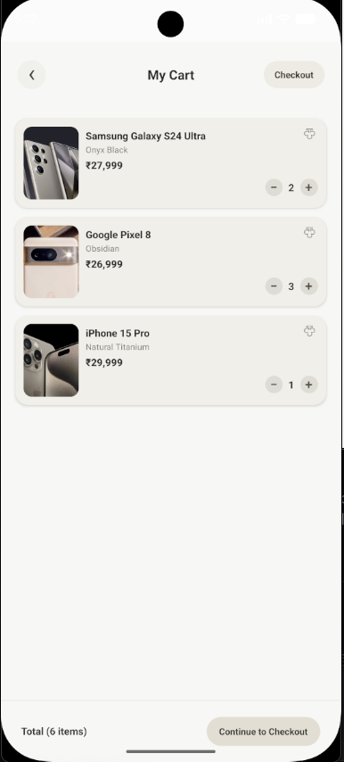

# Redux Add to Cart

A small React Native shopping app I built while learning Redux. It helped me practice keeping shared cart state in one place, dispatching actions, and using reducers to update that state.

You can browse phones, add them to your cart, and change item quantities. Cart updates are reflected across the app.

## Screenshots

| Products | Products with cart quantities | Cart |
| --- | --- | --- |
|  |  |  |

## Built with

React Native, TypeScript, Redux Toolkit, and React Redux.

## Run locally

```sh
npm install
npm start
```

In another terminal, run `npm run android` or `npm run ios`.
